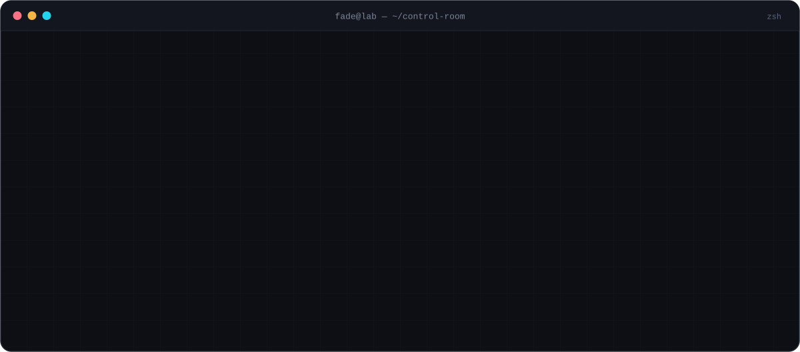
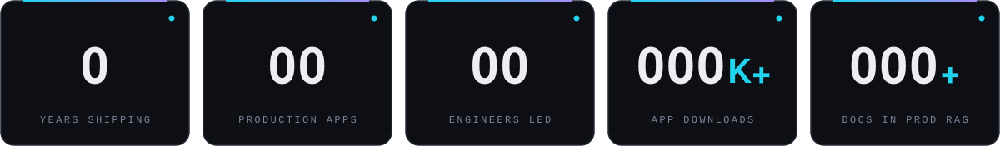

  
  
  

## ⚡ By the numbers

## 🛰️ What I build

<table>
<tr>
<td width="33%" valign="top">

**🤖 AI in production**

A RAG assistant over 500+ platform and compliance documents (OpenAI embeddings, Qdrant, metadata filtering by organization and document type, answers with source citations), plus a LangChain + LangGraph agent. Both are live and used by client organizations.

</td>
<td width="33%" valign="top">

**🧩 Platforms, end to end**

12 production apps across React + TypeScript, React Native, Node.js/Express, Python and MongoDB, including a Module Federation micro-frontend platform where independently deployed products share one domain and one auth server.

</td>
<td width="33%" valign="top">

**⚡ Real-time & cloud**

Live auction rooms on Socket.IO, RabbitMQ and Redis, GPS/fleet tracking, SAP sync and payment-gateway callbacks, all on AWS with GitHub Actions, NGINX and PM2.

</td>
</tr>
</table>

## 🔭 How the production RAG system works

## 🧬 PhD research: explainable AI for dermoscopy

| Paper code | What it does |
| --- | --- |
| [**nesy-derm7pt**](https://github.com/fadeahmadofficial-lab/nesy-derm7pt) | *Faithful-by-Construction Neuro-Symbolic Classification of Skin Lesions Using the 7-Point Dermoscopy Checklist.* The checklist itself is the concept-to-diagnosis layer, fixed and differentiable, so concept leakage can't happen and every decision can be audited case by case. |
| [**diagnosis-conditioned-concepts**](https://github.com/fadeahmadofficial-lab/diagnosis-conditioned-concepts)    | *Diagnosis-Conditioned Concept Labels in Dermoscopy.* Measures how strongly concept labels depend on the diagnosis, scores concept models against a diagnosis-only baseline, and audits how concept evaluation is done. |

## 🚀 Flagship work

Built at Infinite Cercle. The products are confidential, so the code isn't public.

<table>
<tr>
<td width="50%" valign="top">

### ♻️ WasteKnot
B2B waste-management and sustainability platform: web app + 2 React Native apps. Chain of custody, vendor and pickup management, live GPS + ETA over Socket.IO, compliance workflows, dashboards with three admin levels, and the RAG assistant and AI agent in production.

`React` `TypeScript` `React Native` `Node.js` `MongoDB` `RabbitMQ` `Qdrant` `LangGraph` `AWS`

</td>
<td width="50%" valign="top">

### 🔨 CerclX E-Auction
Open and invitation-only auctions for industrial scrap. Live bidding rooms for concurrent bidders, Manual Bid and AutoBid, winner selection, and EMD payments through ICICI eCollection with certificates on GridFS.

`TypeScript` `React` `Tailwind` `Socket.IO` `RabbitMQ` `Redis` `MongoDB/GridFS` `NGINX`

</td>
</tr>
<tr>
<td width="50%" valign="top">

### 📱 ScrapTrade · 100K+ downloads
Scrap-trading mobile app, built across the full stack: React Native client, APIs, database design and AWS deployment.

`React Native` `Node.js` `Express` `MongoDB` `AWS EC2`

</td>
<td width="50%" valign="top">

### 🏭 BWG · MRF · Metabin
Pickup requests with hub-assigned drivers, a vendor platform for collections, invoicing and material traceability, and a backend that links a web app and client dashboard to an IoT bin-tracking server.

`React` `Node.js` `Express` `MongoDB` `AWS` `IoT`

</td>
</tr>
</table>

## 💼 Experience

<b>Infinite Cercle</b> · Senior Full Stack Developer &amp; Team Leader · <i>Apr 2022 – present</i>

 

- Lead a team of 12 developers across 10 production products (WasteKnot, ScrapTrade, E-Auction, Metabin, BWG, MRF, ESG, EPR, IWM and a centralized auth server). I own architecture, sprint planning, code review, mentoring and releases.
- Built the core RAG system behind the WasteKnot AI assistant (Python, OpenAI embeddings, Qdrant): embedding pipeline, a vector store of 500+ documents, retrieval filtered by organization and document type, and grounded answers with citations. It runs in production for client organizations.
- Built and deployed a LangChain + LangGraph AI agent for WasteKnot, also in production.
- Designed a Module Federation micro-frontend platform: WasteKnot, E-Auction and ESG deploy independently under one domain, behind a centralized auth server.
- Integrated SAP synchronization, ICICI eCollection payment callbacks for EMD, and GPS/fleet tracking.
- Run AWS (EC2, DocumentDB, S3, ELB, Route 53) for production and staging with CI/CD on GitHub Actions, NGINX and PM2, and led a cost and rightsizing review of a ~40-instance EC2 estate.

<b>Logimax Technologies</b> · Full Stack Developer · <i>Sep 2021 – Mar 2022</i>

 

- Shipped two CRM products end to end: React admin dashboards, Django REST APIs and a React Native mobile app.
- Built responsive dashboards with React, Material-UI and Redux, with authentication and role-based access on web and mobile.
- Turned stakeholder requirements into UI designs and ran usability tests to refine them.

## 🧰 Stack

   
  

  
  
  
  
  
  
  

## 🎓 Education

| Degree | Where | When |
| --- | --- | --- |
| **PhD, Computing Technologies** (explainable AI, deep learning) | SRM Institute of Science and Technology | 2026 – present |
| **MSc, Information Technology** | Bharathiar University | 2022 – 2024 |
| **BSc, Information Technology** | Bharathiar University | 2019 – 2022 |

## 🐍 Contribution snake

<picture>
  <source media="(prefers-color-scheme: dark)" srcset="https://raw.githubusercontent.com/fadeahmadofficial-lab/fadeahmadofficial-lab/output/snake-dark.svg" />
  <source media="(prefers-color-scheme: light)" srcset="https://raw.githubusercontent.com/fadeahmadofficial-lab/fadeahmadofficial-lab/output/snake-light.svg" />
  
</picture>

